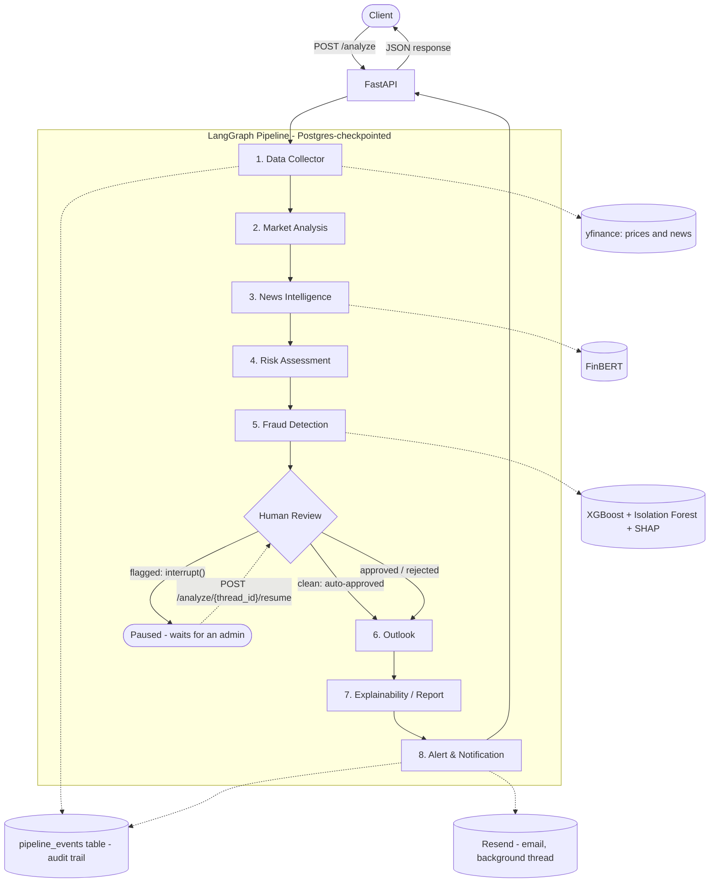

# FinGuardian AI

An 8-agent, LangGraph-orchestrated market analysis backend. It turns public market data and news into an explainable, human-reviewed **analysis outlook** for a stock symbol, behind a JWT-authenticated FastAPI service with a React dashboard.

> **Educational project - not investment advice.** FinGuardian AI is an academic prototype that summarises public data. It does not recommend that anyone buy, sell or hold any security, and it is not registered with SEBI or any other financial regulator. See [Scope and disclaimer](#scope-and-disclaimer).

Built as a B.Tech CSE capstone project.

## Table of Contents

- [Scope and disclaimer](#scope-and-disclaimer)
- [Overview](#overview)
- [Architecture](#architecture)
- [Roles and human review](#roles-and-human-review)
- [Frontend](#frontend)
- [Tech Stack](#tech-stack)
- [Project Structure](#project-structure)
- [Prerequisites](#prerequisites)
- [Setup](#setup)
- [Environment Variables](#environment-variables)
- [Running the Application](#running-the-application)
- [API Reference](#api-reference)
- [Testing and CI](#testing-and-ci)
- [Known Environment Notes](#known-environment-notes)
- [Roadmap](#roadmap)

## Scope and disclaimer

**What this project is.** An educational, automated analysis of public market data. For a given symbol it reports measurable conditions - price momentum, volatility, news sentiment, a rule-based risk score, and an anomaly screen - and summarises them as an *analysis outlook*: **positive signals**, **mixed signals** or **negative signals**. The outlook describes what the data shows. It never tells anyone to act.

**What this project is not.**
- It is not investment advice, a research report, or a recommendation to buy, sell or hold any security.
- It does not personalise anything: no portfolios, goals, risk profiles or suitability checks.
- It is not registered with SEBI (India) or any other financial regulator, and it is not offered for a fee.
- It is not a trading system. Do not base financial decisions on it.

**Known limitations.**
- The fraud / anomaly models (XGBoost + Isolation Forest) are trained on **synthetic data generated at startup**. They have not been validated against real market-manipulation cases, so their output is a demonstration of the technique, not evidence of anything.
- The risk score is a transparent, hand-weighted heuristic. It has not been backtested or validated as a predictor of anything.
- Sentiment comes from FinBERT applied to Yahoo Finance headlines. Yahoo's per-ticker news feed is unreliable (it returned nothing for every symbol in October 2026), so the collector falls back to Yahoo search results, keeping only articles tagged with the symbol whose headline names the company (Yahoo's tags alone let through unrelated stories). Those carry headlines but usually no summaries. Sentiment only counts when at least three relevant articles back it; otherwise the outlook says it is unavailable instead of treating it as neutral. Data from free sources can be delayed, incomplete or wrong.
- Only large US-listed symbols have been exercised.

**Regulatory note.** In India, investment advice and research analysis are regulated activities. This repository is shared as a non-commercial academic prototype. If you plan to run it publicly or commercially, take your own legal advice first.

**Data terms.** Prices and news headlines come from `yfinance`, an unofficial wrapper around Yahoo Finance endpoints that its authors describe as intended for research and personal use. Review Yahoo's terms before deploying or commercialising anything built on this.

## Overview

A client sends `POST /analyze` with a stock symbol. Behind that single request, eight coordinated agents run in sequence: pulling live market and news data, scoring sentiment, assessing risk, screening for anomalies, pausing for a human reviewer when warranted, summarising the signals into an outlook, writing a plain-English report, and dispatching an alert if needed. Every run is checkpointed in Postgres (Supabase) via LangGraph, so a paused case survives a server restart and can be resumed later with a single API call.

**No Docker needed to develop.** The database is a hosted Supabase Postgres; you run two processes (API + dashboard). Setup: [SUPABASE_SETUP.md](SUPABASE_SETUP.md). Free deployment (Cloudflare Pages + Google Cloud Run + Supabase): [DEPLOY.md](DEPLOY.md).

## Architecture



**State** flows through all nodes as a single typed `AgentState`, checkpointed to Postgres after every node via `AsyncPostgresSaver`. Fields use LangGraph reducers where they should accumulate (`agent_log`, `alerts_sent`) and plain overwrite where only the latest value matters.

### The agents

| # | Agent | Responsibility |
|---|-------|-----------------|
| 1 | Data Collector | Fetches ~3 months of daily prices/volume and news headlines (yfinance), rejects unknown tickers, records a completion event |
| 2 | Market Analysis | Computes price change %, volatility (std of daily % returns, 20 sessions), 5-day range, momentum and volume ratio |
| 3 | News Intelligence | Scores each article with FinBERT and aggregates to one confidence-weighted sentiment score |
| 4 | Risk Assessment | Combines volatility, sentiment and momentum into a transparent 0-100 risk score with named factors |
| 5 | Fraud Detection | XGBoost and Isolation Forest screen the case; SHAP explains which features drove the score |
| - | Human Review | Pauses the graph for flagged cases via `interrupt()`; clean cases pass straight through |
| 6 | Outlook | Summarises risk, momentum, sentiment and any human decision as positive / mixed / negative signals. Describes conditions only |
| 7 | Explainability / Report | Assembles every agent's output into one readable report, translating SHAP values into plain language, with the disclaimer attached |
| 8 | Alert & Notification | Decides alert severity (critical / warning / none), records it in `pipeline_events`, and sends an email in the background (inline, or via Celery if configured) |

## Roles and human review

- **Users** can run analyses and see their own history. They cannot approve or reject flagged cases.
- **Admins** (analysts) see a queue of flagged cases from *other* users and approve or reject them.
- **Separation of duties** is enforced on the server: an admin cannot review a case they submitted themselves (the API returns `403`), and the review queue excludes their own submissions.
- A human decision always overrides the models: a rejected case always produces negative signals.

## Frontend

A React + Vite (JavaScript) dashboard in `frontend/`, styled after a Figtree / Roboto Mono, ink-and-lime design system. It talks to the API only over HTTP (`VITE_API_BASE_URL`) and deploys as static files to Cloudflare Pages.

| Route | Purpose |
|---|---|
| `/` | Landing page: pipeline, features, stack, scope and disclaimer |
| `/login`, `/register` | Auth (registration requires acknowledging the disclaimer); the session survives a page refresh |
| `/app` | Dashboard: KPIs, risk score over time, outlook mix, every symbol you follow with its change since the previous run |
| `/app/analyze` | Run the pipeline with per-agent progress, then the full result |
| `/app/analysis/:id` | Result: price/volume chart, risk gauge with point-by-point breakdown, anomaly screen with SHAP bars, FinBERT news, agent trace, report |
| `/app/history` | Filterable history; tick two rows to compare |
| `/app/compare` | Two runs side by side (same company over time, or two companies): overlaid chart, "what changed", metric deltas, risk and SHAP comparisons |
| `/app/review` | Admin queue of other users' flagged cases with approve / reject |

`frontend/mock/server.mjs` is a dependency-free mock of the API (same JSON shapes, generated data) for UI work without Python or Supabase: `npm run mock`. See [frontend/README.md](frontend/README.md).

## Tech Stack

- **API:** FastAPI, Uvicorn, slowapi (per-endpoint rate limits), CORS
- **Agent orchestration:** LangGraph with Postgres-backed checkpointing
- **Auth:** JWT + bcrypt, role-based access control
- **Database:** Supabase (PostgreSQL) via SQLAlchemy (async, asyncpg) + Alembic; RLS locks the tables away from Supabase's public API
- **Audit trail:** `pipeline_events` table (optional Redis Streams mirror); optional Celery for email
- **ML:** FinBERT (`ProsusAI/finbert`), XGBoost, scikit-learn `IsolationForest`, SHAP
- **External data:** yfinance (prices and news)
- **Email:** Resend
- **Frontend:** React 19 + Vite (JavaScript), hand-rolled SVG charts, no UI library
- **Tooling:** pytest, GitHub Actions CI

## Project Structure

```
finguardian-ai/
├── .github/workflows/tests.yml   # CI: pytest against a real Postgres service
├── supabase/                     # SQL to run in the Supabase SQL Editor (schema, lockdown, maintenance, admin)
├── alembic/                      # migrations (env.py excludes LangGraph's checkpoint tables)
├── app/
│   ├── agents/
│   │   ├── state.py              # shared AgentState
│   │   ├── data_collector.py
│   │   ├── market_analysis.py
│   │   ├── news_intelligence.py
│   │   ├── risk_assessment.py
│   │   ├── fraud_features.py     # fraud_detection_node lives here
│   │   ├── human_review.py
│   │   ├── outlook.py
│   │   ├── report.py
│   │   └── alert_notification.py
│   ├── events/event_bus.py       # pipeline_events writer (+ optional Redis mirror)
│   ├── notifications.py          # alert email (inline / celery / disabled)
│   ├── disclaimer.py             # single source for disclaimer text
│   ├── graph.py                  # single source of truth for graph wiring
│   ├── main.py                   # FastAPI app and routes
│   ├── celery_app.py, tasks.py
│   ├── config.py, database.py, models.py, schemas.py
│   └── security.py, dependencies.py
├── frontend/                     # React + Vite dashboard (Cloudflare Pages)
├── tests/                        # pytest suite
├── scripts/manual/               # old ad-hoc dev scripts (not part of the test suite)
├── requirements.txt              # runtime
├── requirements-dev.txt          # + pytest
└── requirements-optional.txt     # celery + redis, only if you want them
```

## Prerequisites

- Python 3.11, Git
- A free [Supabase](https://supabase.com) project
- Optional: a free [Resend](https://resend.com/signup) API key for alert emails

## Setup

Full step-by-step guide with troubleshooting: **[SUPABASE_SETUP.md](SUPABASE_SETUP.md)**. Short version:

1. Create a Supabase project, open **SQL Editor**, run `supabase/01_schema.sql`.
2. Copy the **Session pooler** connection string (Connect button), and build `.env` from `.env.example`.
3. Install and run:

```bash
python -m venv venv
venv\Scripts\activate        # Windows
# source venv/bin/activate   # macOS/Linux
pip install -r requirements-dev.txt

uvicorn app.main:app --reload                 # API on :8000
cd frontend && npm install && npm run dev     # dashboard on :5173
```

4. After the API has started once, run `supabase/02_lockdown_langgraph_tables.sql`.

## Environment Variables

| Variable | Required | Notes |
|---|---|---|
| `DATABASE_URL` | Yes | Supabase **Session pooler** URL as `postgresql+asyncpg://...:5432/postgres?ssl=require` |
| `JWT_SECRET` | Yes | At least 32 characters |
| `LANGGRAPH_DB_URL` | No | Derived from `DATABASE_URL` when empty; must not be port 6543 |
| `APP_ENV`, `JWT_ALGORITHM`, `JWT_EXPIRE_MINUTES` | No | `development`, `HS256`, `60` |
| `DB_POOL_SIZE`, `DB_MAX_OVERFLOW`, `SQL_ECHO` | No | `5`, `5`, `false` |
| `CORS_ORIGINS` | No | Comma-separated browser origins |
| `ALERT_DELIVERY` | No | `inline` (default) / `celery` / `disabled` |
| `RESEND_API_KEY`, `ALERT_RECIPIENT_EMAIL`, `ALERT_FROM_EMAIL` | No | Without key + recipient, alerts are recorded but not emailed |
| `REDIS_URL` | No | Empty = no Redis at all |
| `PRELOAD_MODELS` | No | `true` loads FinBERT at startup |

The frontend reads one variable, `VITE_API_BASE_URL` (default `http://localhost:8000`), from `frontend/.env.local` or the Cloudflare Pages settings.

## Running the Application

Two processes:

```bash
uvicorn app.main:app --reload                 # API
cd frontend && npm install && npm run dev     # dashboard -> http://localhost:5173
```

To create an admin, register an account and then promote it in the Supabase SQL Editor:

```sql
UPDATE public.users SET role = 'admin' WHERE email = 'you@example.com';
```

Log out and back in afterwards so the app picks up the new role.

## API Reference

Interactive docs: `http://localhost:8000/docs`. Authenticated routes expect `Authorization: Bearer <token>`.

| Method | Path | Auth | Description |
|---|---|---|---|
| `POST` | `/register`, `/login` | No (5/min, 10/min) | Create an account / get a JWT |
| `GET` | `/me` | Yes | Current user, including role |
| `POST` | `/analyze` | Yes (5/min) | Run the full pipeline for a symbol |
| `GET` | `/analyses?limit=&offset=` | Yes | Your own analysis history (paginated) |
| `GET` | `/analyses/{thread_id}` | Yes | Full detail (your own; any if admin) |
| `POST` | `/analyze/{thread_id}/resume` | Admin | Approve or reject a flagged case (not your own) |
| `GET` | `/admin/pending-reviews` | Admin | Flagged cases from other users |
| `GET` | `/health` | No | Health check including a database ping |

**Example response from `POST /analyze`** (abridged):

```json
{
  "thread_id": "analysis-f43a93f8",
  "status": "completed",
  "symbol": "AAPL",
  "risk_score": 27.9,
  "risk_factors": ["Elevated price volatility (2.63)"],
  "fraud_flag": false,
  "requires_human_review": false,
  "human_decision": "approved",
  "outlook": "positive_signals",
  "outlook_rationale": "AAPL: risk score 27.9/100, up momentum, sentiment +0.19 -> positive signals.",
  "final_report": "FinGuardian AI Analysis Report - AAPL\n...",
  "alerts_sent": [],
  "disclaimer": "FinGuardian AI is an educational, automated analysis of public market data. ..."
}
```

When a case is flagged, `status` is `"pending_review"` and an admin resolves it through the resume endpoint.

## Testing and CI

```bash
pip install -r requirements-dev.txt
pytest -v
```

The suite covers technical-indicator maths (including NaN and price-level regression tests), input validation (symbols, passwords, emails), connection-string handling, alert-email escaping, risk scoring against hand-calculated values, the outlook logic, alert severity rules, report generation, news-feed normalisation, graph wiring, and API authentication. Two tests deserve a mention: one asserts that a human rejection always overrides the models, and one asserts that the outlook engine never emits advice language (buy / sell / hold / avoid / recommend).

GitHub Actions runs the suite on every push against a real Postgres service, after applying `supabase/01_schema.sql` and checking that Alembic agrees the database is at head. A real end-to-end `/analyze` call is deliberately excluded, since it depends on live Yahoo Finance data and network access; that path is verified manually.

## Known Environment Notes

- **`WindowsSelectorEventLoopPolicy`** is required before any `asyncio` code runs on Windows: `psycopg`'s async driver is incompatible with the default `ProactorEventLoop`.
- **Windows Smart App Control** can block newly installed compiled packages with an `Application Control policy has blocked this file` error. Turning it off is a one-way setting.
- **Supabase pooler:** use the Session pooler (5432). The transaction pooler (6543) has no prepared statements, which LangGraph's checkpointer needs; the API refuses to start with it.
- **Alembic and LangGraph:** `AsyncPostgresSaver.setup()` creates its checkpoint tables outside SQLAlchemy. The `include_object` filter in `alembic/env.py` stops `--autogenerate` from generating a migration that drops them.
- **Role changes** made in the database take effect after the user logs out and back in.
- **Keep `requirements.txt` fresh.** A local virtualenv hides missing entries; CI does not.

## Roadmap

- [x] Automated pytest suite and GitHub Actions CI
- [x] React dashboard with history, comparison and admin review queue
- [x] Analysis-outlook framing, scope and disclaimer
- [ ] Public showcase and/or hosted demo
- [ ] MinIO storage for generated reports
- [ ] Observability stack (Prometheus, Grafana, OpenTelemetry, Loki)
- [ ] Verified sending domain for Resend
- [ ] Open-source LICENSE
